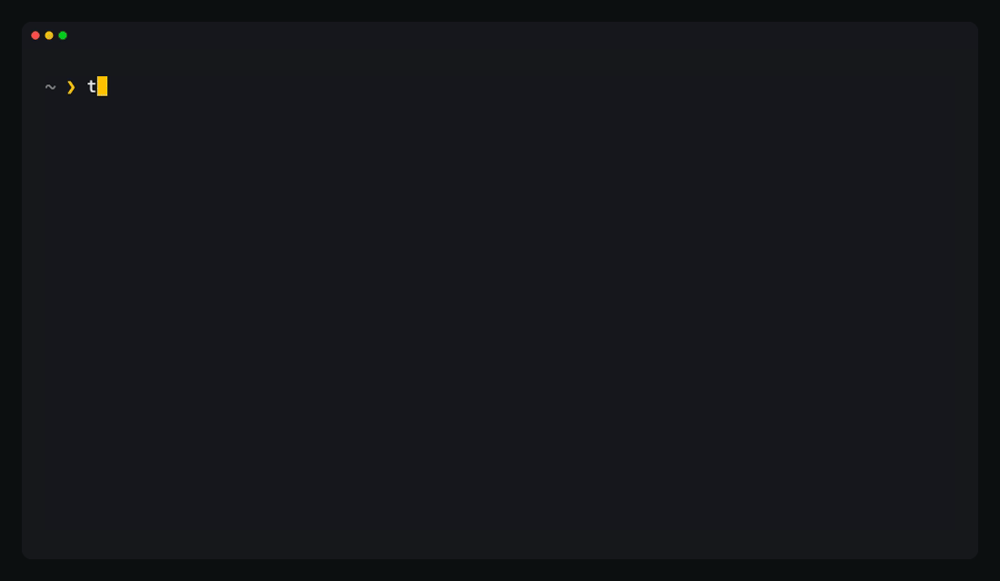

<p align="center">
  
</p>

<h1 align="center">Tuxius</h1>

<p align="center">
  <b>SSH, without the typing.</b><br>
  Save your servers once. Type <code>tuxius</code>, pick one, you're in.
</p>

<p align="center">
  <a href="https://github.com/erdinckaya97/tuxius/actions/workflows/ci.yml"></a>
  <a href="https://github.com/erdinckaya97/tuxius/releases/latest"></a>
  <a href="LICENSE"></a>
  
</p>

<p align="center">
  <a href="https://erdinckaya97.github.io/tuxius">Website</a> ·
  <a href="#install">Install</a> ·
  <a href="#usage">Usage</a> ·
  <a href="#security">Security</a> ·
  <a href="README.tr.md">Türkçe</a> ·
  <a href="README.ru.md">Русский</a>
</p>

<p align="center">
  
</p>

---

Tired of typing `ssh root@203.0.113.10 -p 2222` and digging for passwords? Tuxius is a tiny, fast SSH manager that lives in your terminal: save your servers once and connect with a single keystroke. It's one small binary — no account, no cloud, no GUI.

- **One command** — `tuxius` opens a searchable list of your servers. Arrow keys, Enter, done.
- **Passwordless after the first time** — give Tuxius the root password once; it installs an SSH key on the server and never stores the password.
- **Fuzzy search** — start typing a name or IP to filter the list.
- **Direct connect** — `tuxius web` jumps straight in (unique prefixes work too).
- **Run remote commands** — `tuxius web -- df -h`.
- **Your own SSH keys** — import the keys you already use, generate new ones, delete them. Removing a server can also revoke its key on the server.
- **Zero dependencies** — a single ~1 MB Rust binary that drives your system's OpenSSH. Linux, macOS and Windows.
- **Plain-text config** — one readable TOML file you can back up or edit.
- **Speaks your language** — English, Türkçe and Русский, picked up from your system automatically.

## Install

```sh
curl -fsSL https://raw.githubusercontent.com/erdinckaya97/tuxius/main/install.sh | sh
```

Works on **Linux** (x86_64, arm64) and **macOS** (Intel, Apple Silicon). The script downloads the right binary to `/usr/local/bin` (or `~/.local/bin`).

**Windows** (10 / 11, x64 and ARM) — in PowerShell:

```powershell
irm https://raw.githubusercontent.com/erdinckaya97/tuxius/main/install.ps1 | iex
```

It installs `tuxius.exe` to `%LOCALAPPDATA%\Programs\tuxius` and adds it to your `PATH`; then use it from PowerShell, cmd or Windows Terminal. Tuxius uses the OpenSSH client that ships with Windows.

<details>
<summary>Other ways</summary>

**With Cargo**

```sh
cargo install --git https://github.com/erdinckaya97/tuxius
```

**Manually** — grab a `tar.gz` from [Releases](https://github.com/erdinckaya97/tuxius/releases), extract it and move `tuxius` somewhere on your `PATH`.

**Uninstall**

```sh
sudo rm /usr/local/bin/tuxius        # or ~/.local/bin/tuxius
rm -rf ~/.config/tuxius
```

On Windows, delete `%LOCALAPPDATA%\Programs\tuxius` and `%USERPROFILE%\.config\tuxius`.
</details>

## Usage

```sh
tuxius
```

The first time, Tuxius walks you through adding a server:

```
  ▀█▀ █ █ ▀▄▀ █ █ █ █▀
   █  █▄█ █ █ █ █▄█ ▄█
  ssh, without the typing  v0.3.0

› Name      web-prod
› Host      203.0.113.10
› User      root
› Port      22
› Log in with  New Tuxius key (recommended)
› Password  ************
  ◌ Installing SSH key on root@203.0.113.10…
  ✔ Key installed — no password needed from now on
  ✔ Saved web-prod — connect with tuxius or tuxius web-prod
```

After that, `tuxius` shows your servers, most recently used first:

```
› Connect to
❯ web-prod    root@203.0.113.10        key
  db-main     root@203.0.113.24        key
  staging     deploy@staging.acme.dev  password
  + Add a new server
  ✎ Edit a server
  ✕ Remove a server
  ⚿ SSH keys
  ⚑ Language
  ⏻ Quit
  ↑↓ move · type to filter · enter select · esc quit
```

### Commands

| Command | What it does |
| --- | --- |
| `tuxius` | Open the server picker |
| `tuxius <name>` | Connect directly (name or unique prefix) |
| `tuxius <name> -- <cmd>` | Run a command on the server |
| `tuxius add` | Save a new server |
| `tuxius list` | List saved servers |
| `tuxius edit [name]` | Change a server |
| `tuxius rm [name]` | Remove a server (`--revoke` also removes its key from the server) |
| `tuxius key` | Open the SSH key manager |
| `tuxius key list` | List stored keys and which servers use them |
| `tuxius key add` | Import a key file (`--file ~/.ssh/id_ed25519`) or generate one (`--generate`) |
| `tuxius key show [name]` | Print a public key, e.g. to paste into a cloud panel |
| `tuxius key rm [name]` | Delete a key (refused while a server still uses it) |
| `tuxius lang [en\|tr\|ru]` | Change the interface language |
| `tuxius path` | Show where files are stored |

`tuxius add` also takes flags for scripting:

```sh
echo "$ROOT_PASSWORD" | tuxius add --name web --host root@203.0.113.10:22 --password-stdin
tuxius add --name db --host root@203.0.113.24 --key mykey   # log in with a stored key
```

### SSH keys

When you add a server, Tuxius asks how to log in:

- **New Tuxius key (recommended)** — enter the password once; Tuxius installs its own key on the server.
- **My own SSH key** — pick a stored key, or import / generate one right there. If the server doesn't accept it yet, Tuxius can install it using the password.
- **Saved password** — for servers that don't allow keys; kept in your system keychain.

Keys live in `~/.config/tuxius/keys/` (chmod 600). Manage them from the menu (`⚿ SSH keys`) or with `tuxius key`.

### Language

Tuxius speaks **English**, **Türkçe** and **Русский**. It follows your system language (`LANG`) by default. Switch with `tuxius lang ru` or from the menu (`⚑ Language`) — the choice is saved. `TUXIUS_LANG=en` overrides it for a single run.

## Security

- **SSH key (default, recommended).** Tuxius creates its own key at `~/.config/tuxius/keys/tuxius` and uses the password **once** to add the public key to the server's `~/.ssh/authorized_keys`. The password is never written to disk.
- **Saved password (opt-in).** If a server doesn't allow keys, you can choose to save the password. It goes to your system keychain — Keychain on macOS, Credential Manager on Windows, GNOME Keyring / KWallet on Linux — never into the config file. On machines without a keychain (e.g. a headless server) it falls back to `~/.config/tuxius/servers.toml`, readable only by you (`chmod 600`). Passwords saved by older versions move to the keychain automatically.
- Removing a server can also remove its key from the server (`tuxius rm --revoke`, or answer *yes* in the menu).
- Passwords are handed to OpenSSH through `SSH_ASKPASS` — never via command-line arguments, so they don't show up in `ps`.
- New host keys are accepted on first connect (`StrictHostKeyChecking=accept-new`); a *changed* host key is still refused, just like plain `ssh`.

## How it works

Tuxius is a thin layer over the OpenSSH client already on your machine. It stores servers in a TOML file:

```toml
[[server]]
name = "web-prod"
host = "203.0.113.10"
user = "root"
port = 22
auth = "key"
```

and, when you pick one, replaces itself with `ssh -i ~/.config/tuxius/keys/tuxius root@203.0.113.10` — so you get a 100% normal SSH session.

## Development

```sh
cargo run              # run locally
cargo test             # unit tests
./tests/e2e.sh         # end-to-end tests against a throwaway sshd in Docker
```

Releases are built by GitHub Actions when a `v*` tag is pushed.

## License

[MIT](LICENSE)
