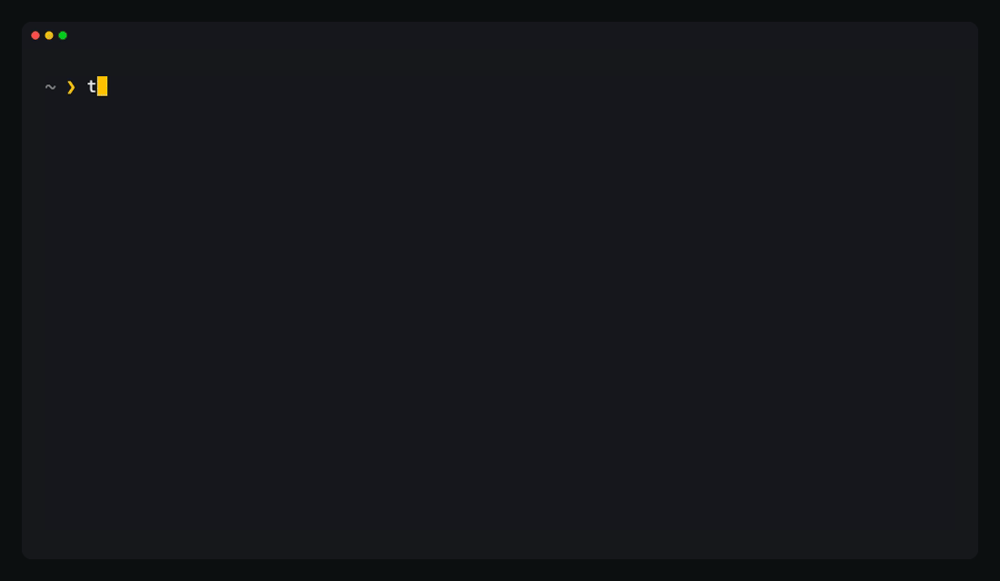

<p align="center">
  
</p>

<h1 align="center">Tuxius</h1>

<p align="center">
  <b>SSH без лишнего набора.</b><br>
  Сохраните серверы один раз. Наберите <code>tuxius</code>, выберите сервер — и вы на месте.
</p>

<p align="center">
  <a href="https://erdinckaya97.github.io/tuxius">Сайт</a> ·
  <a href="#установка">Установка</a> ·
  <a href="#использование">Использование</a> ·
  <a href="#безопасность">Безопасность</a> ·
  <a href="README.md">English</a> ·
  <a href="README.tr.md">Türkçe</a>
</p>

<p align="center">
  
</p>

---

Надоело каждый раз набирать `ssh root@203.0.113.10 -p 2222` и искать пароли? Tuxius — маленький и быстрый SSH-менеджер прямо в терминале: сохраните серверы один раз и подключайтесь одним нажатием. Это один небольшой файл — без аккаунтов, облака и графического интерфейса.

- **Одна команда** — `tuxius` открывает список ваших серверов с поиском. Стрелки, Enter — готово.
- **Без пароля после первого раза** — введите пароль root один раз; Tuxius установит SSH-ключ на сервер и нигде не сохранит пароль.
- **Мгновенный поиск** — начните вводить имя или IP, и список отфильтруется.
- **Прямое подключение** — `tuxius web` подключает сразу (подходят и уникальные префиксы).
- **Удалённые команды** — `tuxius web -- df -h`.
- **Ваши SSH-ключи** — импортируйте существующие ключи, создавайте новые, удаляйте. При удалении сервера можно убрать и его ключ с сервера.
- **Без зависимостей** — один Rust-файл размером ~1 МБ, который использует системный OpenSSH. Linux, macOS и Windows.
- **На вашем языке** — English, Türkçe и Русский; язык определяется по системе автоматически.

## Установка

```sh
curl -fsSL https://raw.githubusercontent.com/erdinckaya97/tuxius/main/install.sh | sh
```

Поддерживаются **Linux** (x86_64, arm64) и **macOS** (Intel, Apple Silicon).

**Windows** (10 / 11, x64 и ARM) — в PowerShell:

```powershell
irm https://raw.githubusercontent.com/erdinckaya97/tuxius/main/install.ps1 | iex
```

Скрипт устанавливает `tuxius.exe` в `%LOCALAPPDATA%\Programs\tuxius` и добавляет его в `PATH`; дальше Tuxius работает в PowerShell, cmd и Windows Terminal. Используется OpenSSH-клиент, встроенный в Windows.

Через Cargo: `cargo install --git https://github.com/erdinckaya97/tuxius`

Удаление:

```sh
sudo rm /usr/local/bin/tuxius        # или ~/.local/bin/tuxius
rm -rf ~/.config/tuxius
```

В Windows удалите папки `%LOCALAPPDATA%\Programs\tuxius` и `%USERPROFILE%\.config\tuxius`.

## Использование

```sh
tuxius
```

При первом запуске Tuxius пошагово поможет добавить сервер: **имя**, **хост**, **пользователь** (по умолчанию `root`), **порт** (по умолчанию `22`), **способ входа** и **пароль**. После этого `tuxius` показывает ваши серверы — недавно использованные сверху.

| Команда | Что делает |
| --- | --- |
| `tuxius` | Открывает список серверов |
| `tuxius <имя>` | Подключается напрямую |
| `tuxius <имя> -- <команда>` | Выполняет команду на сервере |
| `tuxius add` | Сохраняет новый сервер |
| `tuxius list` | Показывает сохранённые серверы |
| `tuxius edit [имя]` | Изменяет сервер |
| `tuxius rm [имя]` | Удаляет сервер (`--revoke` убирает и ключ с сервера) |
| `tuxius key` | Открывает менеджер SSH-ключей |
| `tuxius key list` | Показывает ключи и серверы, которые их используют |
| `tuxius key add` | Импортирует файл ключа (`--file ~/.ssh/id_ed25519`) или создаёт новый (`--generate`) |
| `tuxius key show [имя]` | Выводит открытый ключ (например, для облачной панели) |
| `tuxius key rm [имя]` | Удаляет ключ (запрещено, пока его использует сервер) |
| `tuxius lang [en\|tr\|ru]` | Меняет язык интерфейса |
| `tuxius path` | Показывает, где хранятся файлы |
| `tuxius update` | Скачивает и устанавливает последнюю версию |
| `tuxius sync` | Хранит зашифрованную копию серверов в iCloud, папке или облаке WebDAV |
| `tuxius sync setup` | Выбирает или меняет место этой копии |

### Способы входа

- **Новый ключ Tuxius (рекомендуется)** — вы вводите пароль один раз, Tuxius устанавливает на сервер собственный ключ.
- **Мой SSH-ключ** — выберите сохранённый ключ или импортируйте / создайте его прямо здесь. Если сервер ещё не принимает ключ, Tuxius может установить его с помощью пароля.
- **Сохранённый пароль** — для серверов, где ключи не разрешены; хранится в системном хранилище паролей.

Ключи хранятся в `~/.config/tuxius/keys/` (chmod 600). Управлять ими можно из меню (`⚿ SSH-ключи`) или командой `tuxius key`.

### Синхронизация

`tuxius sync` хранит зашифрованную копию серверов, сохранённых паролей и SSH-ключей. Файл шифруется на этом компьютере до отправки. Парольная фраза в копию не попадает: она остаётся здесь, в системной связке ключей, если она есть.

- **iCloud** — предлагается на Mac, если включён iCloud Drive. Другой Mac с тем же Apple ID её видит.
- **Папка** — Dropbox, OneDrive, Google Drive, Syncthing или любая папка, которая появляется на другом компьютере.
- **Адрес** — папка WebDAV. Так работают Nextcloud, ownCloud и большинство своих облаков: `https://cloud.example/remote.php/dav/files/имя`. Облако не из списка тоже подходит, если синхронизирует папку или говорит по WebDAV.

iCloud есть только на Mac. В Windows и Linux предлагаются папка и адрес. На Mac они тоже есть. Сначала настройте компьютер, где уже лежат серверы, затем на другом выполните `tuxius sync` и введите ту же фразу.

### Язык

Tuxius говорит на **English**, **Türkçe** и **Русский**. По умолчанию используется язык системы (`LANG`). Сменить язык можно командой `tuxius lang ru` или в меню (`⚑ Язык`) — выбор сохраняется. Для одного запуска: `TUXIUS_LANG=en tuxius`.

## Безопасность

- **SSH-ключ (по умолчанию, рекомендуется).** Tuxius создаёт собственный ключ `~/.config/tuxius/keys/tuxius` и **один раз** использует пароль, чтобы добавить открытый ключ в `~/.ssh/authorized_keys` на сервере. Пароль не записывается на диск.
- **Сохранённый пароль (по желанию).** Если сервер не принимает ключи, пароль можно сохранить. Он попадает не в файл настроек, а в системное хранилище паролей: Связка ключей в macOS, Диспетчер учётных данных в Windows, GNOME Keyring / KWallet в Linux. На машинах без хранилища (например, на серверах без графики) он хранится в `~/.config/tuxius/servers.toml`, доступном только вам (`chmod 600`). Пароли, сохранённые старыми версиями, переносятся в хранилище автоматически.
- При удалении сервера можно убрать и его ключ с сервера (`tuxius rm --revoke` или ответ *да* в меню).
- Пароль передаётся OpenSSH через `SSH_ASKPASS`, а не через аргументы командной строки, поэтому он не виден в `ps`.
- **Синхронизируемая копия.** `tuxius sync` шифрует серверы, пароли и ключи на этом компьютере до записи. Парольной фразы в этом файле нет.
- Новые ключи хостов принимаются при первом подключении (`StrictHostKeyChecking=accept-new`); *изменившийся* ключ хоста по-прежнему отклоняется, как и в обычном `ssh`.

## Лицензия

[MIT](LICENSE)
