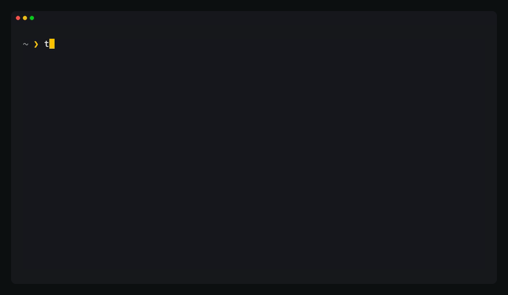

<p align="center">
  
</p>

<h1 align="center">Tuxius</h1>

<p align="center">
  <b>SSH, yazmadan.</b><br>
  Sunucularını bir kez kaydet. <code>tuxius</code> yaz, seç, bağlan.
</p>

<p align="center">
  <a href="https://erdinckaya97.github.io/tuxius">Web sitesi</a> ·
  <a href="#kurulum">Kurulum</a> ·
  <a href="#kullanım">Kullanım</a> ·
  <a href="#güvenlik">Güvenlik</a> ·
  <a href="README.md">English</a> ·
  <a href="README.ru.md">Русский</a>
</p>

<p align="center">
  
</p>

---

Her seferinde `ssh root@203.0.113.10 -p 2222` yazıp şifre aramaktan sıkıldın mı? Tuxius terminalde yaşayan küçük ve hızlı bir SSH yöneticisi: sunucularını bir kez kaydet, tek tuşla bağlan. Tek bir küçük dosya; hesap, bulut ya da arayüz yok.

- **Tek komut** — `tuxius` yaz, sunucu listen gelsin. Ok tuşları, Enter, içeridesin.
- **İlk seferden sonra şifresiz** — root şifresini bir kez gir; Tuxius sunucuya SSH anahtarı kurar ve şifreyi hiçbir yere kaydetmez.
- **Anlık arama** — isim ya da IP yazmaya başla, liste filtrelensin.
- **Doğrudan bağlan** — `tuxius web` direkt bağlanır (benzersiz kısaltmalar da olur).
- **Uzaktan komut** — `tuxius web -- df -h`.
- **Kendi SSH anahtarların** — mevcut anahtarlarını içe aktar, yenisini üret, sil. Sunucuyu silerken anahtarını sunucudan da kaldırabilirsin.
- **Bağımlılık yok** — sistemindeki OpenSSH'ı kullanan ~1 MB'lık tek Rust dosyası. Linux, macOS ve Windows.
- **Senin dilinde** — English, Türkçe ve Русский; sistem dilinden otomatik seçilir.

## Kurulum

```sh
curl -fsSL https://raw.githubusercontent.com/erdinckaya97/tuxius/main/install.sh | sh
```

**Linux** (x86_64, arm64) ve **macOS** (Intel, Apple Silicon) desteklenir.

**Windows** (10 / 11, x64 ve ARM) — PowerShell'de:

```powershell
irm https://raw.githubusercontent.com/erdinckaya97/tuxius/main/install.ps1 | iex
```

`tuxius.exe` dosyasını `%LOCALAPPDATA%\Programs\tuxius` klasörüne kurar ve `PATH`'e ekler; sonra PowerShell, cmd ya da Windows Terminal'den kullanabilirsin. Tuxius, Windows ile gelen OpenSSH istemcisini kullanır.

Cargo ile: `cargo install --git https://github.com/erdinckaya97/tuxius`

Kaldırmak için:

```sh
sudo rm /usr/local/bin/tuxius        # veya ~/.local/bin/tuxius
rm -rf ~/.config/tuxius
```

Windows'ta `%LOCALAPPDATA%\Programs\tuxius` ve `%USERPROFILE%\.config\tuxius` klasörlerini silmen yeterli.

## Kullanım

```sh
tuxius
```

İlk açılışta Tuxius sunucu eklemen için adım adım sorar: **isim**, **adres**, **kullanıcı** (varsayılan `root`), **port** (varsayılan `22`), **giriş yöntemi** ve **şifre**. Sonra `tuxius` yazdığında kayıtlı sunucuların gelir; en son kullandığın en üstte.

| Komut | Ne yapar |
| --- | --- |
| `tuxius` | Sunucu listesini açar |
| `tuxius <isim>` | Doğrudan bağlanır |
| `tuxius <isim> -- <komut>` | Sunucuda komut çalıştırır |
| `tuxius add` | Yeni sunucu kaydeder |
| `tuxius list` | Kayıtlı sunucuları listeler |
| `tuxius edit [isim]` | Sunucuyu düzenler |
| `tuxius rm [isim]` | Sunucuyu siler (`--revoke` anahtarı sunucudan da kaldırır) |
| `tuxius key` | SSH anahtar yöneticisini açar |
| `tuxius key list` | Anahtarları ve hangi sunucuların kullandığını listeler |
| `tuxius key add` | Anahtar dosyası içe aktarır (`--file ~/.ssh/id_ed25519`) ya da yenisini üretir (`--generate`) |
| `tuxius key show [isim]` | Açık anahtarı yazdırır (bulut paneline yapıştırmak için) |
| `tuxius key rm [isim]` | Anahtarı siler (bir sunucu kullanıyorsa izin vermez) |
| `tuxius lang [en\|tr\|ru]` | Arayüz dilini değiştirir |
| `tuxius path` | Dosyaların nerede durduğunu gösterir |
| `tuxius update` | Son sürüme günceller |
| `tuxius sync` | Sunucuların şifreli kopyasını iCloud'da, bir klasörde ya da WebDAV bulutunda tutar |
| `tuxius sync setup` | Bu kopyanın yerini seçer ya da değiştirir |

### Giriş yöntemleri

- **Yeni Tuxius anahtarı (önerilen)** — şifreyi bir kez girersin, Tuxius sunucuya kendi anahtarını kurar.
- **Kendi SSH anahtarım** — kayıtlı bir anahtar seç ya da o an içe aktar / üret. Sunucu henüz kabul etmiyorsa Tuxius şifreyle kurabilir.
- **Kayıtlı şifre** — anahtara izin vermeyen sunucular için; sistemin şifre kasasında saklanır.

Anahtarlar `~/.config/tuxius/keys/` altında (chmod 600) durur. Menüden (`⚿ SSH anahtarları`) ya da `tuxius key` ile yönetilir.

### Eşitleme

`tuxius sync` sunucularını, kayıtlı şifrelerini ve SSH anahtarlarını şifreli bir kopyada tutar. Dosya bu bilgisayardan çıkmadan kilitlenir. Parola kopyanın içinde durmaz; bu bilgisayarda, varsa sistem anahtar zincirinde saklanır.

- **iCloud** — iCloud Drive açık olan Mac'te listede hazır gelir. Aynı Apple hesabındaki diğer Mac de onu görür.
- **Klasör** — Dropbox, OneDrive, Google Drive, Syncthing ya da diğer bilgisayarda görünen herhangi bir klasör.
- **Adres** — WebDAV klasörü. Nextcloud, ownCloud ve kendi kurduğun çoğu bulut bunu kullanır: `https://cloud.example/remote.php/dav/files/adin`. Tuxius bu klasöre `tuxius.vault` dosyasını koyar. Listede adı olmayan bir bulut da, klasör eşitliyorsa ya da WebDAV adresi varsa bağlanır.

iCloud yalnızca Mac seçeneğidir. Windows ve Linux'ta klasör ve adres çıkar. Mac'te bu ikisi de durur. Önce sunucuların durduğu bilgisayarda kur, sonra diğerinde `tuxius sync` deyip aynı parolayı yaz.

### Dil

Tuxius **English**, **Türkçe** ve **Русский** konuşur. Varsayılan olarak sistem dilini (`LANG`) kullanır. `tuxius lang tr` komutuyla ya da menüden (`⚑ Dil`) değiştirebilirsin; seçim kaydedilir. Tek seferlik için `TUXIUS_LANG=en tuxius`.

## Güvenlik

- **SSH anahtarı (varsayılan, önerilen).** Tuxius `~/.config/tuxius/keys/tuxius` adında kendi anahtarını oluşturur, şifreyi **bir kez** kullanarak açık anahtarı sunucunun `~/.ssh/authorized_keys` dosyasına ekler. Şifre diske yazılmaz.
- **Kayıtlı şifre (isteğe bağlı).** Sunucu anahtar kabul etmiyorsa şifreyi kaydetmeyi seçebilirsin. Şifre ayar dosyasına değil, sisteminin şifre kasasına gider: macOS'ta Anahtar Zinciri, Windows'ta Kimlik Bilgisi Yöneticisi, Linux'ta GNOME Keyring / KWallet. Kasası olmayan makinelerde (ör. ekransız sunucular) `~/.config/tuxius/servers.toml` dosyasında, sadece senin okuyabileceğin şekilde (`chmod 600`) saklanır. Eski sürümlerin kaydettiği şifreler otomatik olarak kasaya taşınır.
- Şifre OpenSSH'a `SSH_ASKPASS` üzerinden verilir, komut satırında görünmez.
- **Eşitlenen kopya.** `tuxius sync` sunucuları, şifreleri ve anahtarları bu bilgisayarda şifreler, sonra yazar. Parola o dosyada durmaz.

## Lisans

[MIT](LICENSE)
